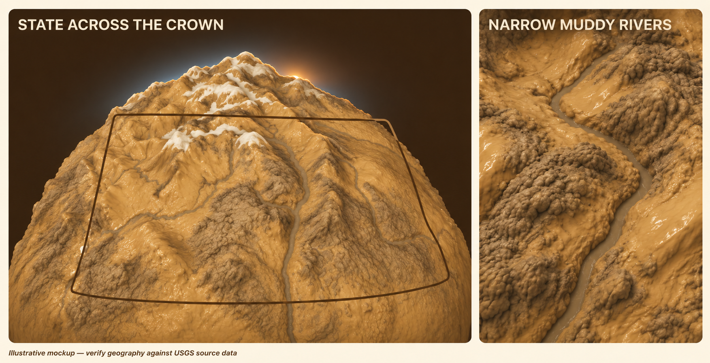
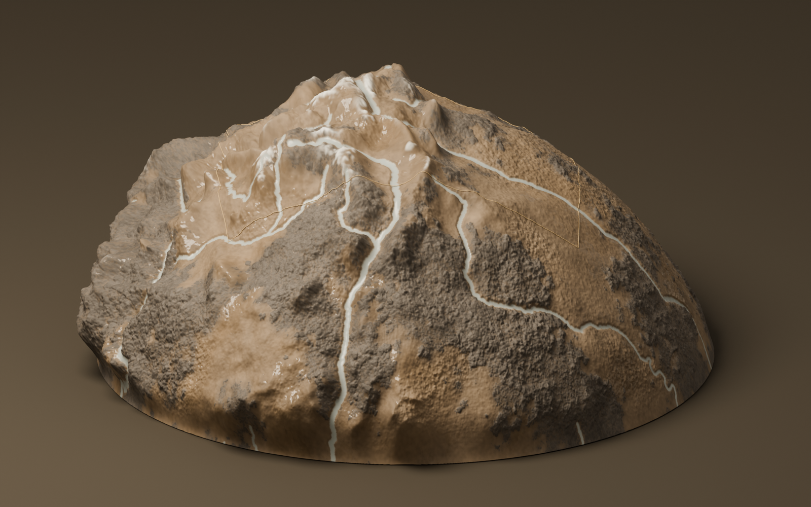
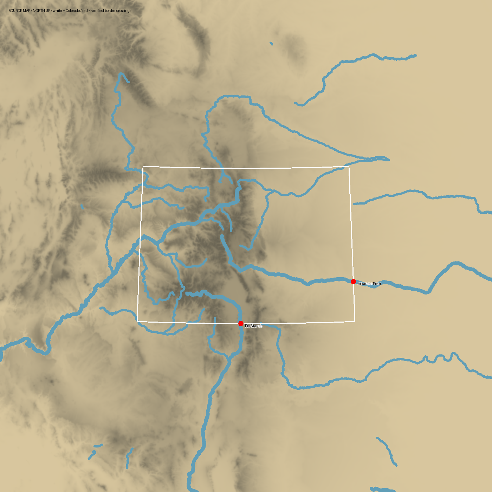

# Colorado crown terrain revision

**Recipient:** Claude implementation agent. **Status:** ready for implementation from the user's accepted style and requested layout corrections. **Date:** 2026-11-13.

Revise the existing Colorado globe model so Colorado occupies most of its visible crown, the eastern plains wrap toward the right shoulder, and rivers are narrower and use the same muddy colour as the San Luis model. Preserve the rounded, lumpy mud appearance the user accepted. Deliver an actual rebuilt model and inspect its real render; the mockups below describe the visual target, not geographic source data.

## 1. Visual brief



**Mockup A, left:** broad Colorado footprint across the visible globe. The west boundary sits near the left flank, the south boundary extends across the foreground, and the east boundary wraps toward the right shoulder. Mountains retain a rounded, strongly exaggerated silhouette. The Front Range is on the right side of the mountain system; the San Juans are on the left in the default south-to-north view.

**Mockup B, right:** a narrower brown-grey river enclosed by irregular mud banks. Rivers remain legible but stop reading as broad white ribbons. Match the San Luis model's water appearance under comparable lighting.

These are AI-generated concept mockups. River geometry, tributary connections, summit positions, and the illustrated boundary shape are **not** geographic evidence. Use the actual USGS sources and the shared map transformation for implementation. The mockup's border is a placement guide, not a rectangular frame to paste over unrelated terrain. The close-up is a material/width guide, not a request for a new braided network or additional LODs.

### Accepted style baseline



The user accepted the **styling**, not the white rivers or small state footprint shown here. Preserve its warm ochre/taupe exposed faces, dark connected clumped deposits, irregular rounded masses, and patchy high-elevation snow. Do not rework the palette or invent a new material direction.

### Geographic reference



White here marks the state boundary on a **diagnostic source map**, not white water in the product. Red dots mark the verified river crossings. This source-map screenshot is an accuracy aid; the cached vectors and elevation are the authoritative geometry.

### Horizon glow and a hint of sun

Add a restrained atmospheric glow along the upper globe/mountain horizon and a small suggestion of sunrise peeking behind the ridge, as shown in the revised mockup above. A thin cool pale-blue rim with soft falloff can pair with a small warm amber halo and a mostly occluded sun sliver, slightly right of centre. The supplied Earth sunrise photo is a lighting/mood reference only; it does not replace the mud surface, geography or globe composition.

Keep the terrain, state outline and narrow muddy rivers dominant and readable. Avoid a large bright sun disk, strong starburst, long lens flares or exposure that washes out mud, snow or water. The glow belongs to the upper horizon, not the globe's ground-contact ring. The effect should follow the globe silhouette as the camera orbits; the sun should be occluded by terrain and remain coherent with the scene light rather than act as a fixed screen sticker.

Treat atmosphere and the sun as scene presentation, separate from the portable terrain material. Document any viewer-specific effect and reproduce the intended look in the hero review render. Do not bake a halo or sun into the terrain's base colour. This feature has not been implemented; the revised image is a mockup for Claude.

## 2. User requirements

| Requirement | Result |
|---|---|
| Geographic extent | All of Colorado plus a minimum 200 statute miles around its boundary, including corner regions. |
| Globe form | Earth emerging from a flat ground plane, with about the upper third exposed; keep the current cap interpretation. |
| State composition | Colorado covers substantially more of the visible crown and foreground, matching the intent of the user's large red outline. |
| Eastern plains | Shorten the apparent Front Range-to-Kansas separation by compressing or wrapping the plains around the right edge. |
| Mountain identity | Use mapped terrain; San Juans left and Front Range right in the default north-facing view. |
| Relief | Strong vertical exaggeration, rounded knuckled summits and connected lumpy mud; avoid needle peaks and sharp faceted polygons. |
| Snow | Sparse irregular patches at genuinely high elevations. White remains available for snow. |
| River colour | Same muddy brown-grey water appearance as the existing San Luis model; no white/cream channels or bright blue water. |
| River width | Narrower than the current broad ribbons while still visible at the overview. |
| Horizon and sun | Subtle upper-horizon atmospheric rim and a restrained, partly occluded warm sunrise; terrain remains the focus. |
| Detail levels | One model resolution; no new LOD hierarchy. |

The latest user instruction is to prepare this handoff for Claude. Continue implementation under Claude rather than treating the current in-progress revision as a finished deliverable.

## 3. Composition and map transformation

The current small state outline encloses too little of the globe. The user drew a much larger outline over the visible upper/front face and explicitly permits the eastern plains to wrap around the right edge.

Use one continuous display transformation for the terrain, river surfaces/masks, state border, snow placement and any geographic markers. Keep the unwarped geographic coordinates separately. The state border must delineate the terrain that actually belongs to Colorado; moving just the outline is insufficient.

**Framing guides, not cadastral measurements:** in a comparable south-facing camera render, aim for the state to span roughly 75–90% of the visible cap width. The west and east boundaries should approach the shoulders, and the south boundary should cross the lower foreground rather than sit near the middle of the dome. Keep the north boundary visible or clearly traceable over the upper surface. The geographic outline can curve with the surface and be partly occluded by real relief.

Make the eastern plains occupy less horizontal screen space between the Front Range and the Kansas boundary. Wrapping the boundary and plains onto the right shoulder is explicitly acceptable. Retain the full buffer beyond it by compressing the peripheral display area instead of deleting the source coverage.

A modest camera adjustment may support the result, but zooming the unchanged small state is insufficient. Preserve a continuous spherical cap and a clean ground intersection. The display warp may change apparent distances; it must preserve geographic ordering, river connectivity and border-crossing alignment, without foldovers or seams. Record the transformation in the manifest.

## 4. Rivers

### Colour and material

The existing San Luis material defines `WATER_LINEAR = (0.42, 0.40, 0.36)` and `WATER_ROUGHNESS = 0.22`. The current worktree extracts these into `bake/style/water_palette.py` for sharing. Use that palette as the starting point and visually compare under comparable light and exposure. Matching constants alone is not sufficient if the renderer still makes water appear white.

Inspect colour-space conversion, vertex colours, channel-edge blending, specular highlights, lighting and exposure. Avoid a pale bank fringe that effectively recreates a white ribbon around darker water. Keep a subtle water sheen and readable irregular banks. Do not darken or remove the accepted snow to solve river colour.

### Width

The baseline uses 10 km full widths for major rivers and 6 km for other selected rivers; the user now wants these narrower. Start around 3–4 km and 1.8–2.4 km respectively, then judge **apparent width after the display warp**. The state magnification can widen the same source mask on screen.

As a comparison guide, target about 35–50% of the baseline screenshot's apparent river width in corresponding reaches at the same camera scale. Adjust locally if required to preserve continuity. Keep Rio Grande, Arkansas, Colorado/Gunnison and the major Platte drainage legible at overview. No tiny high-detail tributaries or new LOD work is required.

Use the actual NHD courses. Do not draw replacement routes, shift rivers independently of the terrain, move confluences, or add a decorative braided network.

### Required geographic checks

| River | Verified source crossing, longitude / latitude |
|---|---|
| Rio Grande into New Mexico | −105.718800866°, 37.000000000° |
| Arkansas into Kansas | −102.050000000°, 38.032389737° |

Keep both crossings on their corresponding transformed state boundaries. Source coordinates must remain unchanged by artistic display mapping.

## 5. Current repository and asset state

**Workspace:** `/Users/splnlss/.paradev/worktrees/3d-mud-terrain/create-new-model-set-441ef5c6`.

The worktree contains uncommitted code and documents from the initial model and an incomplete follow-up revision. Read the working tree, not only committed history. Do not overwrite or reset it wholesale.

| Location | Responsibility / current condition |
|---|---|
| `bake/style/colorado_globe.py` | USGS source fetch/cache, geographic checks, material authoring, cap geometry, border and manifest. A candidate `display_map()` already enlarges Colorado using a disk-preserving warp. |
| `bake/style/water_palette.py` | Candidate shared San Luis water constants. |
| `bake/style/relief_tiles.py` | Uses the shared palette import in the current working tree. Preserve San Luis behaviour. |
| `bake/style/relief_study.py` | Shared mud authoring recipe. Preserve accepted style. |
| `bake/style/blender_colorado_globe.py` | Editable Blender scene, portable GLB, hero/overhead renders and GLB reimport verification. Candidate revision strengthens the state outline. |
| `src/colorado.ts` / `colorado.html` | Dedicated PlayCanvas preview, horizon/map views, state-outline toggle and download. Candidate revision adjusts light intensity toward San Luis. |
| `tests/test_colorado_globe.py` | Coverage, orientation, crossing interpolation, rounded summit shaping and display-warp checks. |
| `docs/colorado-globe.md` | Existing model notes. The original width description predates the latest narrowing request. Update final docs after implementation. |
| `docs/superpowers/specs/2026-11-13-colorado-globe.md` | Earlier scope. This PRD supersedes conflicting appearance/composition requirements. |
| `docs/superpowers/plans/2026-11-13-colorado-globe.md` | Historical execution record; its completed checks refer to the earlier model, not approval of this revision. |

**Generated package:** `/Volumes/TXX_Backup/DustnDivide/05_3D-tiles/colorado-globe/`, linked as `data/colorado-globe` and `public/colorado-globe`.

The follow-up bake completed while the user changed the task to a handoff. Current external `model.npz`, `geography.npz`, `manifest.json`, `colorado-crown.glb`, `colorado-crown.blend`, `hero.png` and `overhead.png` therefore contain the **candidate wider-state/shared-palette revision**. It is not visually accepted and still uses the old **10 km / 6 km** river widths. The narrower-river request has not been implemented.

`hero-v1.png` preserves the earlier style baseline. `portable-hero.png`, `portable-verification.json`, `gltf-validation.json` and `dist-colorado/` may still describe the **previous** model; regenerate them after the final changes. Do not present stale evidence as current validation.

Six geographic/model unit tests passed after the candidate warp changes. The prior complete test run, standalone build and GLB validation predate those follow-up changes. Run fresh verification for the final result.

The candidate `display_map()` uses normalized focus `(-0.18, +0.10)` and radial focus `2.5`. Treat these as an experiment to evaluate, not a user-approved formula. Tune or replace them if the rendered state still misses the user's composition. Current source coverage is a Colorado-centred azimuthal-equidistant circle of radius about 703,719 m, enclosing the state corners plus the 200-mile perimeter and margin.

## 6. Implementation sequence

1. Inspect the baseline, both mockup panels, source geography, actual cached vectors and candidate render. Identify which candidate changes already satisfy the brief.
2. Tune the common display warp so the state footprint and eastern shoulder match the composition target. Verify continuity, coverage and river/border alignment.
3. Narrow the channels and match the San Luis river appearance. Evaluate after the warp and under the actual viewer lights.
4. Add the restrained upper-horizon glow and partly occluded sun as scene presentation; check exposure and camera-orbit coherence. Rebuild the single-resolution source and portable model. Render a fixed hero view, overhead view and river close-up. Use actual renders for acceptance.
5. Reimport the final GLB and compare its material/geometry with the source. Check the browser horizon/map views and outline toggle. Update manifests, docs and build output together.

Processing and source caches belong on the external drive. Keep generated model assets out of git. Existing San Luis sets must continue to work. No deploy, merge or message to another service is requested by this handoff.

## 7. Verification and acceptance

- [ ] Whole Colorado and the 200-mile perimeter remain in the source/model coverage.
- [ ] Default hero view reads as a broad Colorado state across the crown, rather than a small outlined patch.
- [ ] East boundary/plains wrap toward the right shoulder; the Front Range-to-Kansas gap reads shorter.
- [ ] Terrain, rivers and state guide share the same mapping; no fake outline placement, foldovers or seams.
- [ ] San Juans are left and Front Range right from the south-facing view.
- [ ] Rio Grande and Arkansas retain the verified source crossings and meet the correct transformed border segments.
- [ ] Rivers are visibly narrower than the baseline, continuous and muddy coloured under real lighting; no white stripes or pale halos.
- [ ] Rounded clumpy mud and selective snow retain the accepted look; no renewed needle peaks or sharp low-poly facets.
- [ ] Upper-horizon glow and a hint of sun match the mockup without washing out the terrain, turning rivers white, or creating a ground-contact halo.
- [ ] Atmosphere/sun are separate from terrain base colour and behave coherently during camera orbit and terrain occlusion.
- [ ] One model resolution, portable GLB and editable source are delivered.
- [ ] Final source and imported-GLB renders agree. GLB validation has no errors.
- [ ] Fresh `npm test` and `npm run build:colorado` complete successfully; report any warnings or failures accurately.
- [ ] Browser horizon/map views, orbit, state-outline toggle and download work with the rebuilt asset.
- [ ] Manifest records coverage, warp, vertical shaping, final river widths/material and source hashes.
- [ ] User reviews the actual final render. Tests and mockups do not establish visual acceptance.

## 8. Run and delivery

```sh
npm run bake:colorado
# Independently import/render the final portable asset:
blender --background --python-exit-code 1 \
  --python bake/style/blender_colorado_globe.py -- \
  --package data/colorado-globe --verify
npm test
npm run build:colorado
npm run dev -- --port 5197
# Open http://localhost:5197/colorado.html
```

Deliver the final `.glb`, editable `.blend`/source arrays, manifest, updated docs and actual hero/overhead/detail evidence. Explain the authored geographic distortion and give the user the preview/model locations. Keep the mockups labelled as design targets.

## 9. Sources and mockup provenance

- [USGS 3DEP elevation service](https://elevation.nationalmap.gov/arcgis/rest/services/3DEPElevation/ImageServer).
- [USGS NHD small-scale flowlines](https://hydro.nationalmap.gov/arcgis/rest/services/nhd/MapServer/4).
- Accepted local mud references: `docs/reference/style-studies/01-braided-channels.png`, `02-ridge-level.png`, `04-canyon.png`, `05-layered-peaks.png` and the style baseline supplied here.
- `target-horizon-glow.png`: built-in image generation edit of the original target board, adding only subtle upper-horizon atmosphere and a small warm sun hint. This is the current presentation target. The earlier `target-composition-and-rivers.png` is retained for reference.
- `target-composition-and-rivers.png`: generated with the built-in image generation tool from the user's annotated screenshot. It illustrates layout, river width and material only. The generation brief is included in `mockups/generation-brief.txt`.
