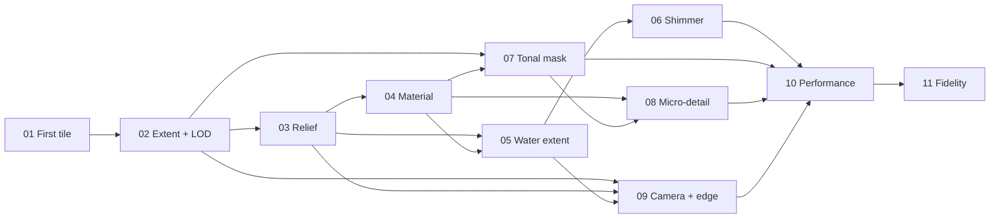

# Vertical-slice task index

Each ticket ends with a visible browser result and touches bake inputs, 3D Tiles output, and viewer behaviour. Execute in numerical order unless dependencies permit parallel work. Do not start a horizontal-only infrastructure ticket.

| Order | Slice | Blocked by | Browser result |
|---|---|---|---|
| 01 | [First terrain tile](01-first-terrain-tile.md) | — | One flat-shaded San Luis DEM tile renders. |
| 02 | [Full extent and LOD](02-full-extent-lod.md) | 01 | Entire valley streams with seamless LOD. |
| 03 | [Remapped clod relief](03-remapped-clod-relief.md) | 02 | Rounded ridges and stronger low relief. |
| 04 | [Crust, granular, dust](04-crust-granular-dust.md) | 03 | Two-tone aged model material. |
| 05 | [Painted water extent](05-painted-water-extent.md) | 03, 04 | Flat rivers, reservoir, and acequias. |
| 06 | [Subtle water shimmer](06-subtle-water-shimmer.md) | 05 | Matte water with faint motion. |
| 07 | [Satellite tonal mask](07-satellite-tonal-mask.md) | 02, 04 | Pivots and fields as muted tone. |
| 08 | [Sparse model detail](08-sparse-model-detail.md) | 04, 07 | Tiny flecks and pale strands. |
| 09 | [Camera and diorama edge](09-camera-and-diorama-edge.md) | 02, 03, 05 | Bounded oblique view and sculpted edge. |
| 10 | [Mobile performance](10-mobile-performance-pass.md) | 06, 07, 08, 09 | Smooth, budget-compliant mobile scene. |
| 11 | [Reference fidelity sign-off](11-reference-fidelity-signoff.md) | 10 | Reviewed style match and final scene. |

